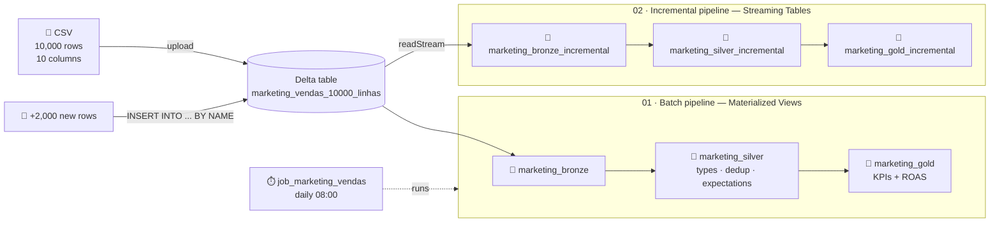

<p align="center">
  
</p>

<p align="center">
  
  
  
  
  
</p>

<p align="center">
  
  
  
  
</p>

---

## 🎯 About this project

Hands-on **data engineering** lab built on **Databricks Free Edition**: an end-to-end ETL for a **marketing & sales** dataset, following the **Medallion Architecture** (Bronze → Silver → Gold) with **Lakeflow Declarative Pipelines** (`from pyspark import pipelines as dp`).

It goes from a raw CSV to channel-level business KPIs (revenue, spend, orders, **ROAS**), adding **data quality rules**, **job orchestration** and **incremental ingestion** with Streaming Tables — the same building blocks used in production lakehouses.

## 🏗️ Architecture



## 🗂️ Repository structure

```text
Pipelines-databricks/
├── pipelines/
│   ├── 01_batch/marketing_pipeline.py                     # Bronze → Silver → Gold (Materialized Views)
│   └── 02_incremental/marketing_pipeline_incremental.py   # Streaming Tables + MV
├── sql/
│   ├── 01_validate_layers.sql      # row counts per layer
│   ├── 02_gold_kpis.sql            # revenue, spend, orders and ROAS per channel
│   ├── 03_data_quality.sql         # null checks on Silver
│   ├── 04_incremental_insert.sql   # simulate new data arriving (+2,000 rows)
│   └── 05_validate_incremental.sql # Delta format check + incremental counts
└── docs/
    ├── job.md                      # orchestration with Databricks Jobs
    └── troubleshooting.md          # real errors and fixes
```

## 📊 Dataset

Synthetic marketing & sales data (**10,000 rows**, later **+2,000** for the incremental test), with consistent relationships between impressions → clicks → leads → orders.

| Column | Description | Silver type |
|---|---|---|
| `data` | Operation date | `date` |
| `campanha` | Campaign name | `string` |
| `canal` | Marketing channel | `string` |
| `regiao` | Brazilian region | `string` |
| `impressoes` | Impressions | `int` |
| `cliques` | Clicks | `int` |
| `leads` | Leads generated | `int` |
| `pedidos` | Orders | `int` |
| `investimento_brl` | Marketing spend (R$) | `double` |
| `receita_brl` | Revenue (R$) | `double` |

## 🥉🥈🥇 Medallion layers

| Layer | Dataset | What happens |
|---|---|---|
| 🥉 **Bronze** | `marketing_bronze` | Raw data read from the Delta source table |
| 🥈 **Silver** | `marketing_silver` | Type casting, `dropDuplicates()`, null-date filter, **expectations** |
| 🥇 **Gold** | `marketing_gold` | Aggregation per `canal`: revenue, spend, orders, clicks and **ROAS** |

## ✅ Data quality — Expectations

```python
@dp.expect_or_drop("cliques_validos", "cliques >= 0")
@dp.expect_or_drop("receita_valida", "receita_brl >= 0")
```

| Decorator | Behavior |
|---|---|
| `@dp.expect` | Records the violation, **keeps** the row |
| `@dp.expect_or_drop` | **Drops** the invalid row ← used here |
| `@dp.expect_or_fail` | **Stops** the update |

Pass/fail metrics are visible in the pipeline graph → **Data Quality**.

## 🔄 Incremental ingestion

| | Batch (01) | Incremental (02) |
|---|---|---|
| Decorator | `@dp.materialized_view` | `@dp.table` |
| Read | `spark.read.table()` | `spark.readStream.table()` |
| Processing | Recomputes from source | Only **new rows** since the last checkpoint |
| Requirement | — | Source in **Delta** format, append-only |

**Test scenario:** source with 10,000 rows → `INSERT INTO ... BY NAME` adds 2,000 rows → 12,000 in the source → the streaming Bronze picks up only what is new.

## 🧪 Lab progress

- [x] Build Bronze → Silver → Gold pipeline
- [x] Fix `CLOUD_INVALID_PATH` (file reader vs table reader) — see [troubleshooting](docs/troubleshooting.md)
- [x] Validate layers and KPIs with SQL
- [x] Add data quality rules (expectations)
- [x] Orchestrate with a Databricks Job — see [job](docs/job.md)
- [x] Append +2,000 rows to the Delta source (12,000 total)
- [ ] Run incremental Bronze → Silver → Gold end-to-end and validate counts
- [ ] Incremental deduplication (watermark / keys)
- [ ] Quarantine table for rejected rows

## ▶️ How to run

1. Upload the CSV in **Catalog → Add data** as `workspace.default.marketing_vendas_10000_linhas`.
2. **Jobs & Pipelines → Create → ETL pipeline**, add [`pipelines/01_batch/marketing_pipeline.py`](pipelines/01_batch/marketing_pipeline.py), set catalog `workspace` / schema `default`, then **Run pipeline**.
3. Validate with the queries in [`sql/`](sql/).
4. (Optional) Create the Job described in [`docs/job.md`](docs/job.md).
5. For the incremental flow, create a second pipeline with [`pipelines/02_incremental/marketing_pipeline_incremental.py`](pipelines/02_incremental/marketing_pipeline_incremental.py) and follow `sql/04` → `sql/05`.

## 💡 PySpark ↔ SQL cheat sheet

| SQL | PySpark |
|---|---|
| `SELECT col` | `.select("col")` |
| `SELECT *, expr AS col` | `.withColumn("col", expr)` |
| `WHERE` | `.filter()` |
| `GROUP BY` | `.groupBy()` |
| `SUM()` | `F.sum()` |
| `CASE WHEN` | `F.when()` |
| `CAST()` | `.cast()` |
| `DISTINCT` | `.distinct()` |
| `JOIN` | `.join()` |
| `ORDER BY` | `.orderBy()` |

---

<sub>👤 Part of <a href="https://github.com/MatheusFelipePereira">Matheus Felipe Pereira's portfolio</a> · <a href="https://www.linkedin.com/in/matheus-felipe-p/">LinkedIn</a></sub>
