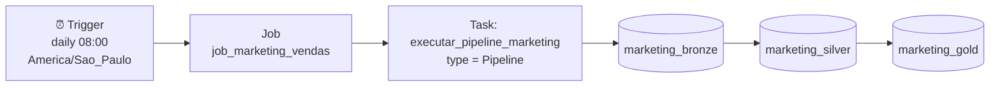

# ⏱️ Orchestration — `job_marketing_vendas`

A **Databricks Job** runs the batch pipeline automatically. The pipeline already contains all processing (Bronze → Silver → Gold), so the Job needs **a single task**.

## Task configuration

| Field | Value |
|---|---|
| Job name | `job_marketing_vendas` |
| Task name | `executar_pipeline_marketing` |
| Type | **Pipeline** |
| Pipeline | Marketing batch pipeline (Bronze/Silver/Gold) |
| Full refresh | Off |

## Schedule

| Setting | Value |
|---|---|
| Trigger type | Scheduled |
| Frequency | Daily |
| Time | 08:00 |
| Timezone | America/Sao_Paulo |

> For the lab, the Job can also be run manually with **Run now** to avoid unnecessary executions.

## Result

✅ Job executed with status **Succeeded**.

## Job vs Pipeline vs Notebook

| Resource | Role |
|---|---|
| **Notebook** | Write, test and explore code interactively |
| **Pipeline** | Declare *how* data is transformed (datasets + dependencies) |
| **Job** | Decide *when* and *in what order* tasks run (scheduling, retries, alerts) |

A notebook task could be added after the pipeline (e.g. extra validation or a report), but it is optional here.
